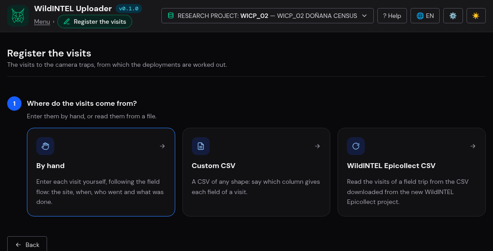
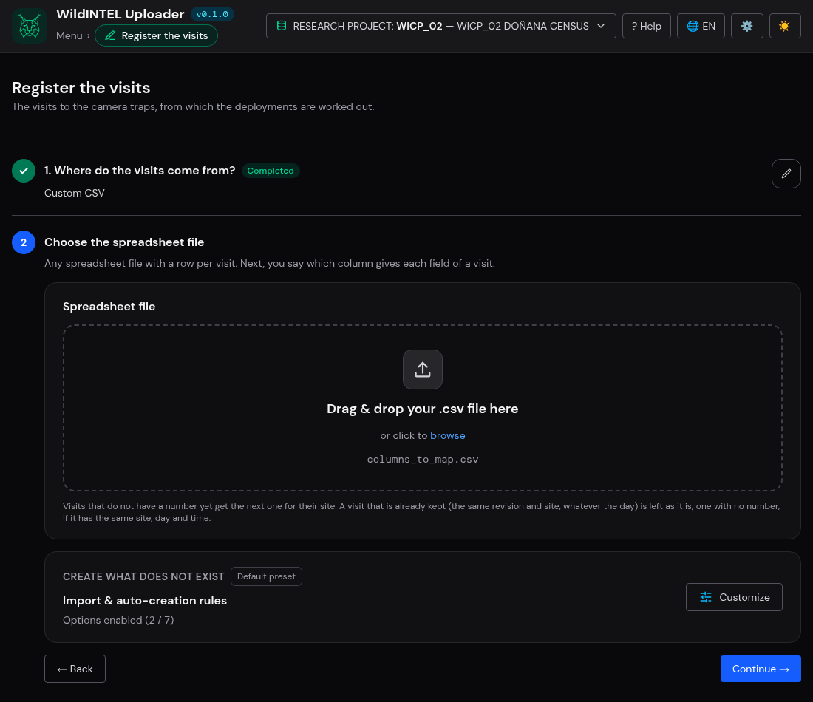
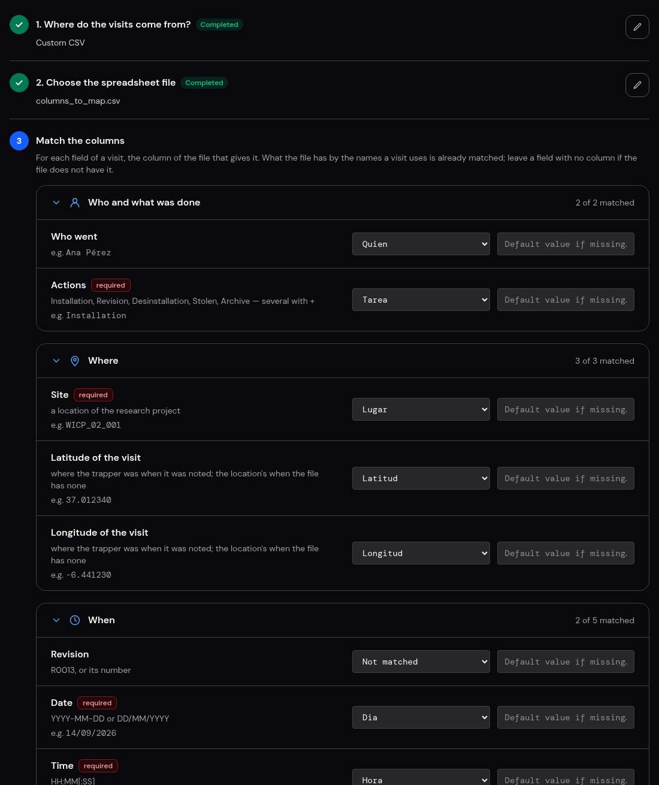
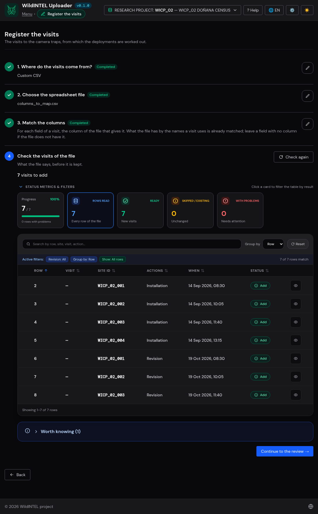
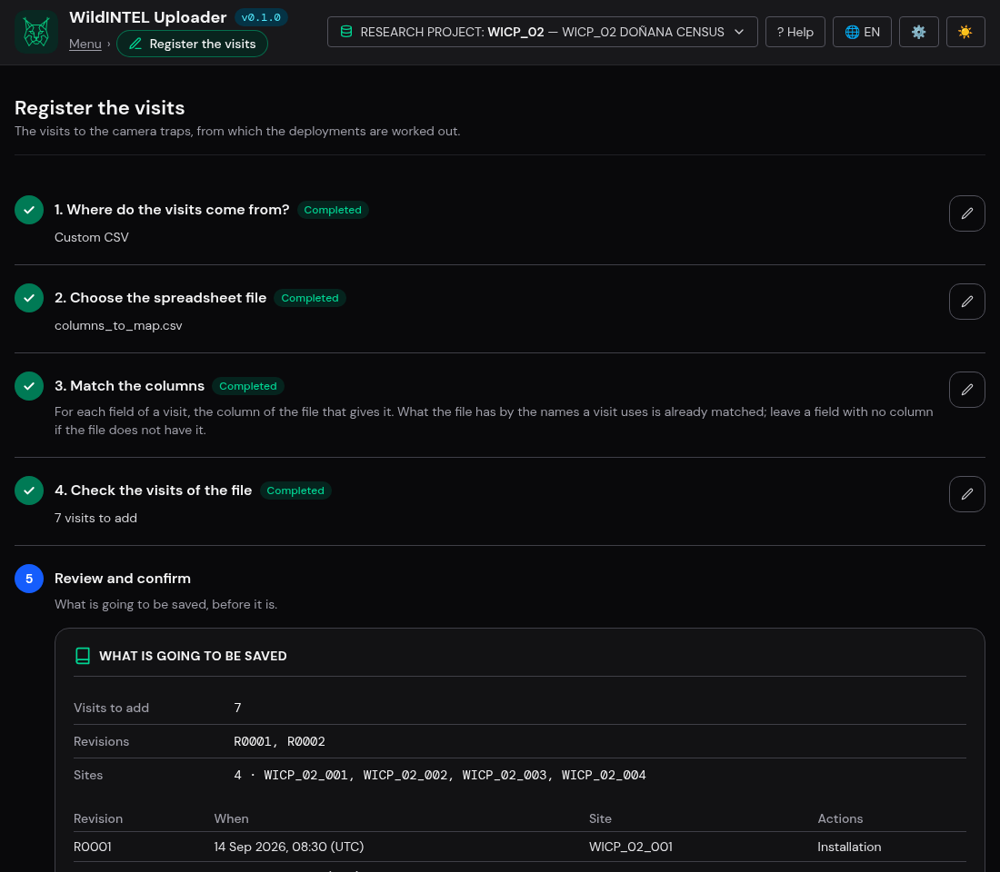
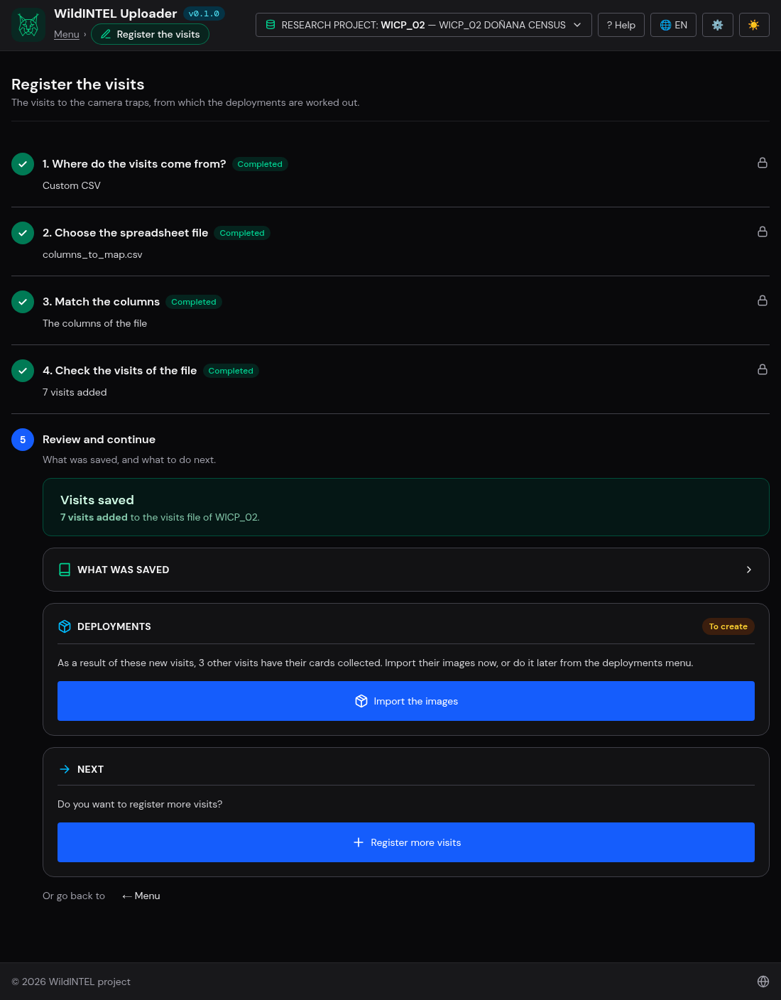

# Guide — Import the visits from a custom CSV

This guide takes you, step by step, from a spreadsheet with a **row per visit** to the visits registered in the application. The file can have **any shape**: you say, in the application, which column gives each field of a visit.

!!! info "What this guide is, and is not"
    It is a walk-through of one task. What each screen and each rule means is in the [web manual](user-manual-web.md#custom-csv), and the ideas behind it — visits, revisions, deployments — in the [general concepts](user-manual.md#26-visits-and-revisions). If the file is the download of the WildINTEL Epicollect form, use [that guide](guide-visits-epicollect.md): nothing has to be mapped there.

## Before you start

You need:

- **A research project** with its **locations**, defined in *Settings › Entities*.
- **The cameras, SD cards and trappers** the file names, registered there too — or let the import create them (see [step 2](#2-choose-what-the-import-may-create)).
- **A CSV file** with a row per visit.

!!! tip "Load the revisions in order"
    A revision does not start until the one before it is finished, and the visits of a revision are after those of the revisions before. A file may have many revisions; the application orders the visits by their instants.

## What the file needs

Each row is **one visit**. Only two things are always required, and each may come from a column **or** from a default you give when mapping:

| Field | Required | What it is |
|---|---|---|
| `location_id` | **yes** | The site: a location of the research project. |
| `actions` | **yes** | What was done: `Installation`, `Revision`, `Desinstallation`, `Stolen`, `Archive` (and `SiteStart`). Several are joined with `+`: `Stolen + Installation`. |
| `date` and `time` | one of the three ways | The day (`2026-09-14` or `14/09/2026`) and the time (`08:30` or `08:30:00`), or both in one column (`when`), or the instant of an Epicollect entry (`created_at`). |
| `latitude`, `longitude` | yes for a visit, but the file need not have them | Where the trapper was when the visit was noted. A row with none takes those of its location. |
| `session` | no | The revision (`R0013`, or its number). A row with none gets **the next revision of its site**. |
| `trappers` | no | Who went. Several are separated by **commas** (`Ana Pérez, Luis Gómez`): any other sign — an `&`, a `+` — is read as part of one name, and the row is refused (*Ana Pérez & Luis Gómez is not one of the trappers*). |
| `camera_id`, `sd` | by action | An Installation needs the camera and the card it leaves; a Revision, the camera and the card left. |
| `num_photos` | by action | The images collected from the card (a Revision or a Desinstallation; not when the card was full). |
| `status`, `card_batteries_ok`, `comments`, `camera_height`, `camera_tilt`… | no | The state of the camera and the details of its set-up. |

!!! example "A minimal file"
    ```csv
    location_id,session,date,time,actions,trappers,camera_id,sd,num_photos,latitude,longitude
    WICP_02_001,R0001,2026-09-14,08:30:00,Installation,Ana Pérez,BR5071050724,1,,37.012340,-6.441230
    WICP_02_002,R0001,2026-09-14,10:05:00,Installation,Ana Pérez,RE5699252753,2,,37.025750,-6.452680
    WICP_02_001,R0002,2026-10-19,09:10:00,Revision,Ana Pérez,BR5071050724,5,1432,37.012340,-6.441230
    ```

**Name the columns as the fields are named** and the application matches them by itself (`location_id`, `session`, `date`, `time`, `actions`, `trappers`, `camera_id`, `sd`, `num_photos`…). Some common names in Spanish or English (`Lugar`, `Fotos`, `Camara`, `Observaciones`, `latitud`…) are matched too; the rest you pick by hand in step 3.

!!! warning "Care with the ids"
    **The case counts** for an SD card, a camera and the full name of a trapper: `7b` and `7B` are two SD cards. The sites and the research projects are read whatever their case. A card id with spaces or signs (`84 (10)`, `38_B`) is kept as written and told among what is odd.

## 1. Open *Register the visits › Custom CSV*

From the task menu press **Register the visits** and choose **Custom CSV**. It is always offered and cannot be turned off. The research project is the default one; change it if the visits are for another.



Drop the CSV in the file area or browse for it. Semicolons or commas, and accents, are fine.

!!! note "Visits that already live in an Epicollect5 project"
    When Epicollect is turned on in *Settings › Visit sources › Epicollect*, the step first asks **where the CSV is**: *A file on this computer* or *Epicollect5 project*. With the latter, **Download the entries** reads them from the project of the settings and goes on as a file does.

Choosing the file does **not** move on: the step stays open with **Import & auto-creation rules**.



## 2. Choose what the import may create

**Customize** opens the switches for the entities the file names that are not in the project:

| Switch | What it asks of the file |
|---|---|
| **Create the locations that do not exist** | `location_latitude` and `location_longitude` (the coordinates **of the location**, not of the visit), `timezone` (e.g. `Europe/Madrid`) and `daylight_saving` (`yes` if its cameras follow summer time). Optional: `location_name`, `coordinate_uncertainty`. |
| **Create the cameras that do not exist** | `camera_id`; optional `camera_model`. |
| **Create the SD cards that do not exist** | `sd`; optional `sd_brand`, `sd_capacity`. |
| **Create the trappers that do not exist** | Nothing more: the username is worked out from the name (`Ana Pérez` is `ana.perez`). Complete them later in *Settings › Trappers*. |
| *The images were not counted* | Accepts a Revision or a Desinstallation with no image count: the count stays empty, **no number is invented**. |
| *Use the coordinates of the location when a row has none* | On by default: a row with no coordinates takes those of its location. With it off, such a row is refused. |
| *Close the revision before when it has locations still planned* | Marks the locations still planned in the revision before as *Not revised*, so the new revision can start. |

In a custom CSV the entity-creation switches **start cleared**, because creating asks for more columns. Each one you turn on adds those fields to the matching, where a default can also be given.

Press **Done**, then **Continue**.

## 3. Match the columns

For each field of a visit, say which column of the file gives it. The fields are in groups, as in the form by hand — *Who*, *Where*, *When*, *The visit*, *SD card*, *Camera*, *Site*, and *Grouping and notes* —, each a card with a chevron that folds it away and a count (*3 of 5 matched*), and an **example from the file** beside each field.

- What has the name of a field is **matched by itself**. Check it, and pick the rest.
- For a field the file has **no column for**, give a **default** that every row takes.
- **The site and the actions are required**: every row gives them, by a column or a default.
- **The time** is a date and a time, or — when the file has it — the instant of an entry (`created_at`). Dates may be written day first.
- **The coordinates** of the visit: `latitude` and `longitude` are required of a visit, but the file need not have them. One of the two alone is refused.



The screenshot is of `columns_to_map.csv`: the headers are in Spanish and the separator is a semicolon, so `Quien`, `Tarea`, `Lugar`, `Dia` and `Tarjeta` are picked by hand, while `Hora`, `Latitud` and `Longitud` were matched by themselves.

Press **Read the visits**.

## 4. Check the visits of the file

The check starts when you press **Read the visits**. A long history can take some minutes. Then the page says what the file holds — *N visits to add · N already kept · N rows with a problem* —, the new sites, what is worth knowing and what is odd, and lays out the rows like a dashboard:



- **Revision selection**, **Status metrics & filters** and **the table** (search, **Group by** *Row* or *Error*). Each row has a **Status**: *Add*, *Add · to check*, *Skipped / Existing*, *Skipped / Ignored* or *Error*. The **chevron** opens the errors of a row and the **eye** opens a panel with the row field by field.

**A row with a problem is not kept.** Rows are refused when a field cannot be read — *a date that is not a date*, *actions that are not Site start, Installation, Revision, Desinstallation, Stolen or Archive*, a card code that is not valid, an image count that is not a whole number — or when they break [a rule of a visit](user-manual-web.md#the-rules-of-a-visit), each with a label of its own. Correct the file — or the settings — and **read it again**: there is no editing of a row in the page.

Frequent cases:

- **A site that is not a location.** It may be new or a misprint. The page shows how far its first visit was from the nearest location and the locations whose id is one character apart. If it is new, turn on **Create the locations that do not exist** (and give the columns it needs) or create it in *Settings › Locations*; if it is a misprint, correct the id.
- **The revision before is not finished.** A notice names the revision and the missing locations and offers **Mark them as not visited and read again**.
- **A row already kept** (same revision and site) is left as it is and counted as *already kept*.

Open **Worth knowing** to read what is not an error: sites not visited on this trip (their cameras are still out), visits where nothing was collected, a jump in the revision numbers.

When the rows are what you expected, press **Continue to the review**.

## 5. Review and confirm

The last step lists **what is going to be saved** — the visits, the revisions and sites, and the locations, cameras, SD cards and trappers that are created —, and warns that **the visits cannot be changed once they are created**. Press **Add N visits**.



Afterwards the step turns green (*Visits saved*), and **What was saved** has the summary.



 A **report** of the import is written beside the visits (`visits_import_<day>_<time>.txt`), and the folder of every collection the visits touch is made, with its logs.

## 6. What next

- Open the **Visit dashboard** to follow each revision and the state of each visit.
- If the visits **collected** SD cards, press **pick their revision and import their images** to go on to [Import deployment](user-manual-web.md#import-a-deployment).
- **Show the deployments** lists, by collection, the deployments the visits say.

## Common problems

| What you see | What it means |
|---|---|
| *Luis Gómez is not one of the trappers* | Register the trapper in *Settings › Trappers*, or turn on **Create the trappers that do not exist**. |
| *Camera not in the research project* / *SD card not in the research project* | Register it in *Settings › Entities*, or turn on the matching switch in step 2. |
| *Something its actions ask is missing* | An Installation needs the camera and the card; a Revision, the camera and the images collected. Map the columns, give a default, or turn on *The images were not counted* for an old datasheet. |
| *First visit is not an Installation* | The first visit to a site puts the camera up. |
| *Visit not after the last one of the site* / *Revision out of order* | The date or the revision is out of order with the visits already kept. |
| *R0043 cannot start: R0042 is not finished* | The revision before has sites with no visit. Add them to the file, or use **Mark them as not visited and read again**. |
| Dates read wrongly | Only `2026-09-14` and day first (`14/09/2026`) are read; a month-first date is a row with a problem. |

## Try it with the examples

The folder [`examples/visits_example/custom_csv/wicp_02`](https://github.com/wildintelproject/wildintel-uploader/tree/main/examples/visits_example/custom_csv/wicp_02) has a file for each case — all correct (`valid.csv`), three revisions, a visit that could not be made, a theft and a site given up, rows that cannot be read, columns to map by hand (`columns_to_map.csv`: semicolons, Spanish headers, dates day first) and one that creates the locations, cameras and cards it names (`create_entities.csv`) —, each with what to expect in its README. They are made for the entities in [`examples/entities_example/wicp_02`](https://github.com/wildintelproject/wildintel-uploader/tree/main/examples/entities_example/wicp_02): import them first, with the research project `WICP_02` picked, and load each file on a project with no visits.
