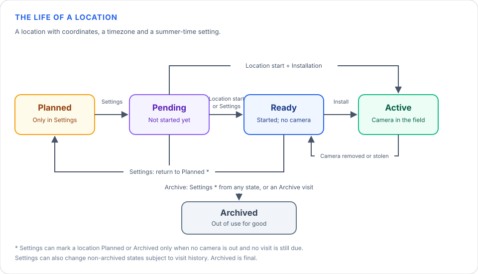

# WildINTEL Uploader — User Manual

**WildINTEL Uploader** is an application for camera-trap projects. It takes a set of images — copied off the camera's
SD card —, checks them, organizes them in a local folder with their metadata (renamed, resized, tagged with
authorship and license and sealed), and sends them to different camera-trap projects like [TRAPPER](https://gitlab.com/trapper-project/trapper).
It runs on your own computer; features such as TRAPPER uploads, Epicollect connections and background maps use external services. It comes in
two faces that share the same settings, the same log and the same collections folder:

- a **web application**, with a guided interface in your browser — the complete one;
- a **command line**, for the quick jobs.

---

## Table of Contents

1. [Installation](#1-installation)
2. [General concepts and workflow](#2-general-concepts-and-workflow)
3. [The folders and files it creates](#3-the-folders-and-files-it-creates)
4. [Where to go next](#4-where-to-go-next)

---

## 1. Installation

Download the file for your system from the
[releases page](https://github.com/wildintelproject/wildintel-uploader/releases). 

=== "Linux"

    Download `wildintel-uploader-X.Y.Z-linux-x86_64.AppImage`, make it executable and run it:

    <div class="termy">

    ```console
    $ chmod +x wildintel-uploader-X.Y.Z-linux-x86_64.AppImage
    $ ./wildintel-uploader-X.Y.Z-linux-x86_64.AppImage
    ```

    </div>

=== "Windows"

    Download `wildintel-uploader-X.Y.Z-windows-x64.exe` and double-click it. If Windows SmartScreen
    warns that the publisher is unknown, choose **More info → Run anyway**.

=== "macOS"

    Download `wildintel-uploader-X.Y.Z-macos-arm64.dmg` (Apple Silicon), open it and copy
    `wildintel-uploader` out of it to a folder of your own (for example *Applications* or your home folder).

    !!! warning "The app isn't signed by an Apple developer"
        macOS blocks what it can't verify, so the first time it will refuse to open it ("Apple could not
        verify…"). Either:

        - Try to open it once, then go to **System Settings › Privacy & Security**, scroll down to the
          message about `wildintel-uploader` and press **Open Anyway**; or
        - remove the quarantine mark from a terminal, once, and run it:

        <div class="termy">

        ```console
        $ xattr -d com.apple.quarantine ./wildintel-uploader
        $ chmod +x ./wildintel-uploader
        $ ./wildintel-uploader
        ```

        </div>

!!! tip "Running it from the source code"
    To run the app from its source code — or to change it — see the
    [developer manual](developer-manual.md#2-development-setup).

One download gives you both the web application and the command line.

## 2. General concepts and workflow

Before starting to work with the tool it is worth clarifying a few concepts and the workflow that is followed.

First a **[research project](#21-research-projects)** is defined: what we want to study, where, who will do it and how. The *what* and the *how* are in the definition of the project itself. To say *who*, the **[trappers](#22-trappers-and-roles)** are created, with the **role** each one has in the project. Then come the areas where the camera traps will be put up — the **[locations](#23-locations)**. In them cameras will be installed, revised and taken away, so the **[cameras](#24-cameras)** have to be created in the app, and so do the **[SD cards](#25-sd-cards)** that go in them.

Once all these entities exist, the locations are gone round and things are done in them: that is a **[visit](#26-visits-and-revisions)**, and all the visits to all the locations are a **[revision](#26-visits-and-revisions)**. Often the result of a visit is a recovered SD card. From it a **[deployment](#27-deployments-and-collections)** is made: the images taken at a location during a period, and in some conditions. All the deployments of a revision are a **[collection](#27-deployments-and-collections)**, and the collections can be **[uploaded](#28-uploads)** to the camera-trap portals.


Each of them is explained below, in the same order. The things the visits are about come first, then the visits, because everything else is worked out from them.

### 2.1 Research projects

A **research project** is the study that everything else belongs to: its locations, cameras, SD cards, roles, visits, deployments and collections are all kept in its own folder, and are never mixed with those of another. It says:

- **What** is studied and **how**: to establish it, the project is given a **description**, an **abstract**, the **methods** used, some **keywords** and the choices that TRAPPER's own form asks — the *sampling design*, the *sensor method*, the *animal types*, the *use of bait* and the *interval between events*. The project itself is identified by its **name** and its **acronym**.
- **Where**: its locations (see [Locations](#23-locations)).
- **Who**: its trappers and their roles (see [Trappers and roles](#22-trappers-and-roles)).

A research project is always in one of four **states**:

<div class="states" markdown>

| State | Meaning |
|---|---|
| **Planned** | The project is being prepared. It has **no visits** yet. |
| **Active** | The study is **running**: it is offered when visits are registered and deployments imported. |
| **Finished** | The fieldwork is **over**. It is not offered when a deployment is imported, but it can be **reopened**. |
| **Archived** | The project is **out of use for good**. It is **final**: nothing in it can be changed — nor its locations, cameras, SD cards, roles or visits — and it never goes back. |

</div>

The following diagram shows the **transitions allowed** between the states. Where it says **by settings**, the change is made **by hand**, in the settings of the application.


From **any state** a project can be archived, and it goes back to *planned* only if it has **no visits**. A finished project is not offered when a deployment is imported, but it can be reopened.

### 2.2 Trappers and roles

A **trapper** is a person who takes part in the study: who goes to the field, sets the cameras up or is responsible for the data. It has a **username** (required, with no spaces, and different from every other), a **full name** — how a visit says who went —, an **affiliation** and an **email**, which are optional. Trappers belong to no research project: they are the same whatever the project.

A trapper is always in one of three **states**:

<div class="states" markdown>

| State | Meaning |
|---|---|
| **Active** | The trapper still **goes to the field**: it is suggested when a visit says who went. |
| **Inactive** | The trapper **no longer goes**: it is not suggested. It keeps what it did — its visits and its roles still say who it is — and can be made active again. |
| **Archived** | The trapper is **out of use for good**. It is **final**: it never goes back. |

</div>

The following diagram shows the **transitions allowed** between the states. Where it says **by settings**, the change is made **by hand**, in the settings of the application.


From **any state** a trapper can be archived. An inactive trapper can be made active again; an archived one never goes back.

What a trapper is in a research project is its **role**, and is kept in that project.

The roles are:

| Role | What it is |
|---|---|
| **contact** | who to ask about the data |
| **principalInvestigator** | who leads the study |
| **rightsHolder** | who holds the rights over the data |
| **publisher** | who publishes the data |
| **contributor** | who takes part in any other way (the default) |

A trapper can have several roles in a project, and different ones in each. They are managed in the settings of the application.

!!! info "The roles are those of Camtrap DP"
    The roles are the ones the **Camtrap DP** format gives to the contributors of a dataset, so the metadata of a collection says them as that format expects. They are described in its specification, under [`contributors.role`](https://camtrap-dp.tdwg.org/metadata/#contributors.role).

### 2.3 Locations

A **location** is a **GPS coordinate** — a latitude, a longitude and how uncertain it is — to which we add its **timezone** and whether its cameras **ignore summer time**.

!!! info "Why a location has a timezone"
    The images a camera takes say **when** they were taken, but **not in which timezone**. An image that says *2:00* may have been taken at 2, at 3 or at 4 o'clock of the real time, or at any other, depending on the timezone of the place where the camera is. So the timezone — and whether the cameras there **ignore summer time**, that is, whether their clocks are changed in summer or not — is what the app uses to turn the time of the camera into a complete date and time in **ISO 8601** form, with its offset to UTC, such as `2025-07-15T02:00:00+02:00`.

    In our example the camera says *2:00* on a July day. If the location is in the timezone of Madrid and its cameras follow summer time, the real time is 2:00 of the summer time, `02:00:00+02:00`, which is 00:00 UTC. If the cameras there ignore summer time, their clocks are always in winter time, and the same *2:00* is `02:00:00+01:00`, which is 01:00 UTC.

A location is always in one of five states:

<div class="states" markdown>

| State | Meaning |
|---|---|
| **Planned** | The site is planned. It is only in **Settings**, to link cameras and cards to it: it is **not in the app** — no visit is kept to it and no list offers it. |
| **Pending** | The site is in the app but has not started yet. Its first visit starts it; earlier revisions do not wait for it. New sites from initial setup and TRAPPER imports are pending. |
| **Ready** | The site is **ready to have a camera**. It is in the app: the revisions count it, and a visit can put a camera up there. |
| **Active** | The site **has a camera**. It is in the app, as a ready one. |
| **Archived** | The site is **out of use for good**. It is **final**: it never goes back, and no visit is kept to it after the day it was archived. |

</div>

The diagram shows the main transitions. Settings can also change non-archived states, subject to the visits and the restrictions described below.



The **actions done in a visit** (see [the actions of a visit](#the-actions-of-a-visit)) can change the state of a site, and so can the **settings** of the application, where you can set it by hand. In particular, what moves a location from one state to another:

- **Planned → Pending**: you say so in Settings, when the site is ready to be used.
- **Pending → Ready or Active**: a visit starts the site; if it also installs a camera, the site becomes active.
- **Ready → Active**: a visit does an **Installation**, which puts a camera up. Only a visit makes a site active: it cannot be set by hand.
- **Active → Ready**: a visit takes the camera away (**Desinstallation**) or finds it stolen (**Stolen**), and puts no other one up. A replacement — the camera is taken away and another put up — keeps it active.
- **Ready or Pending → Planned**: in Settings, to take the site out of the app again.
- **→ Archived**: an **Archive** visit gives the site up (it goes with a Desinstallation or a Stolen visit, as no camera can be left), or you archive it in Settings, **from any state** — a planned site that is given up before it is used included. It never goes back.

What Settings can do is limited by what the visits say. A site goes **out of the app** — to *Planned* or to *Archived* — only when **no camera is out** there (no visit of it is *Deployed*) and **no visit is still to be made** in a revision that has begun: a revision needs the visit of every site in it. Until then Settings says what is in the way, and the site stays as it was.

The dashboards and revisions wait for the sites that have started and are **ready or active**. A pending site is not waited for until its first visit starts it.

**The location owns the timezone.** A camera's clock has no timezone of its own: its images say "13:10", and the same camera, elsewhere, would say it too. So the timezone (and whether the cameras there ignore summer time) belongs to the location, never to a deployment. They are asked for when a location is added, and every deployment there is read in them; the deployment's details say it before you fill anything in. A location without a timezone is reported — the app doesn't guess one.

### 2.4 Cameras

A **camera** is one device — its serial number, its model and how it is set up — and it is **put up at a site** by a visit. A site has **one camera at a time**, and a camera is at **one site at a time**: it cannot be put up where it already is, nor at a second site before it is taken away from the first, and no other camera can be put up at a site that has one until it is taken away — a replacement is a Revision, a Desinstallation and an Installation in one visit.

A camera is always in one of four states:

<div class="states" markdown>

| State | Meaning |
|---|---|
| **Planned** | The camera is registered in **Settings** but it is **not in the app** yet: no visit offers it. |
| **Ready** | The camera is **available**, and not in the field. A visit can put it up. |
| **Active** | The camera is **put up at a site**. |
| **Archived** | The camera is **out of use for good**: stolen, lost or broken (the reason is kept). It is **final**. |

</div>

The following diagram shows the **transitions allowed** between the states. Where it says **by settings**, the change is made **by hand**, in the settings of the application.


The **actions done in a visit** (see [the actions of a visit](#the-actions-of-a-visit)) can change the state of a camera, and so can the **settings** of the application, where you can set it by hand. In particular:

- **Planned → Ready**: you say so in Settings.
- **Ready → Active**: an **Installation** puts the camera up at a site, and the site becomes active with it. Only a visit makes a camera active: it cannot be set by hand.
- **Active → Ready**: a **Desinstallation** takes it away; a replacement takes the old camera away and puts the new one up.
- **Ready → Planned**: in Settings, to take the camera out of the app again.
- **→ Archived**: a **Stolen** visit finds it gone, or you archive it in Settings — a lost or a broken camera — when it is *planned* or *ready*. It never goes back.

A camera that is put up at a site is **Active**, and only a visit makes it so or takes it out of that state — an Installation puts it up; a Desinstallation, or a Stolen visit, takes it away. So Settings cannot change an active camera, and cannot make one active.

### 2.5 SD cards

An **SD card** is kept in a camera: a visit **leaves** it there (an *Installation*, or a *Revision* that changes the card) and the next visit **collects** it (a *Revision* or a *Desinstallation*) — its images are the deployment. A card is in **one camera at a time**.

An SD card is always in one of four states:

<div class="states" markdown>

| State | Meaning |
|---|---|
| **Planned** | The card is registered in **Settings** but it is **not in the app** yet. |
| **Ready** | The card is **free**: it is in no camera, and a visit can leave it in one. |
| **Active** | The card is **in a camera**, in the field. |
| **Archived** | The card is **out of use for good**: stolen with its camera, lost or broken. It is **final**. |

</div>

The following diagram shows the **transitions allowed** between the states. Where it says **by settings**, the change is made **by hand**, in the settings of the application.


The **actions done in a visit** (see [the actions of a visit](#the-actions-of-a-visit)) can change the state of an SD card, and so can the **settings** of the application, where you can set it by hand. In particular:

- **Planned → Ready**: you say so in Settings.
- **Ready → Active**: a visit **leaves** the card in a camera (*Installation* or *Revision*). Only a visit makes a card active: it cannot be set by hand.
- **Active → Ready**: a visit **collects** it (*Revision* or *Desinstallation*), and the card is free again — it cannot be left again in the same revision.
- **Ready → Planned**: in Settings, to take the card out of the app again.
- **→ Archived**: a **Stolen** visit archives it with its camera, because it went with it, or you archive it in Settings — a lost or a broken card — when it is *planned* or *ready*. It never goes back.

A card that is in a camera is **Active**, and only a visit makes it so or takes it out of that state — it leaves the card in a camera, or collects it. So Settings cannot change an active card, and cannot make one active.

### 2.6 Visits and revisions

A **visit** is one trip to one camera trap, to do something with it. It is the field record: it says when it was, at which site, who went, what was done to the camera and the card, and what was found. The visits of a research project are registered in the application, with **Register the visits**, and everything else is worked out from them. Many visits can be registered at once from a file, step by step in the guides for the [WildINTEL Epicollect CSV](guide-visits-epicollect.md) and for a [custom CSV](guide-visits-csv.md).


A **revision** is a round of visits to the sites of a research project — the 1st, the 2nd, the 3rd one, called `R0001`, `R0002`, `R0003`… A site is visited **once** in a revision, and a revision does not start until the one before it is finished (every expected location has its visit). Pending sites are not expected before they start; archived sites are not expected after they are archived. Revisions are in order: every visit of a revision is after those of the revisions before it.


#### The states of a visit

A visit has a state that follows its life. A visit that left no camera has none.


The drawing reads from left to right, and the state of a visit is decided in three moments:

1. **Before it is registered**, a visit is *planned* or *unknown*. It is **planned** when the revision has visits and the site has none yet: it is the visit that is expected. It is **unknown** when nothing is known of it — the first visit kept to a site is of a later revision, so the revisions before it have no visit of that site: no day, no camera, no card. Nothing is checked against an unknown visit, it counts as a visit to finish its revision, and a visit that comes later takes its place.
2. **When it is registered**, what the visit did gives its state. If it **left a camera** — an Installation — it is **Deployed**: the camera is out and its card is still to be collected. If it **could not be made** (its status is *Not revised*) it is **Not visited**: nothing was done at it. If it **left no camera**, its state is **No camera**: no camera is out and nothing is waited for. A Desinstallation takes the camera away, a Stolen visit finds it gone and an Archive gives the site up; the visit before them, the one that left that camera, is the one that becomes **Collected** (its card was collected) or **Stolen** (its camera was found stolen).
3. **When a later visit to the site** collects the card, or finds the camera stolen, the **Deployed** visit is closed: **Collected** if its card was collected, **Stolen** if the camera was found stolen — there are no images to import. While neither happens it stays *Deployed*. A Revision or a Desinstallation collects the card, and a Stolen visit finds the camera stolen: each closes the *Deployed* visit before it.

The table sums up each state and what it means.

<div class="states" markdown>

| State | What it says |
|---|---|
| **Planned** | The visit is not made yet: a location with no visit in a revision that has them. |
| **Deployed** | It left a camera that is still out: its card has not been collected. |
| **Collected** | A later visit collected the card it left. |
| **Stolen** | The camera it left was stolen: its deployment is closed with no images, and there is nothing to create. |
| **Not visited** | The visit could not be made. |
| **No camera** | It left no camera: it took it away (Desinstallation), found it stolen (Stolen) or gave the site up (Archive). Nothing is waited for. |
| **Unknown** | A revision of a site of which nothing is known: no visit of that site is kept to it. |

</div>

Whether the images of a visit are stored is another thing: they are once its deployment is made.

#### The actions of a visit

The **actions that can be done during a visit** depend on **what the visit before it left at the site** — the last one made there, or the one before it if that was not visited. The diagram below details the relationship between the **state the visit before had** and the **new state it takes** (*Deployed → Collected*), the **actions done in this visit** — the ones that cause that change in the visit before —, the **state this visit is left in**, and the **changes it produces in other entities**: the cameras, the SD cards and the site.


- **No visit before** the site, or one that left **no camera** (a Desinstallation, a Stolen visit or an Archive): there is no camera to look at, so the visit can only put one up — an **Installation**, which leaves it **Deployed** —, give the site up (**Archive**, which leaves it **No camera**) or not be made. The first visit to a site is always an Installation.
- **A Deployed visit** — a camera is out — is closed by the visit after it: **Collected** when it collects its card (a **Revision** or a **Desinstallation**) and **Stolen** when it finds the camera gone (**Stolen**). That visit is left **Deployed** if it puts a camera up (a Revision, a replacement, or a Stolen visit and an Installation) and **No camera** if it does not.
- **No camera** is a **final** state: nothing waits for that visit, so it never changes to another one.
- **Not visited** changes nothing: the camera is where it was, and the next visit is of the visit before.
- **After an Archive** the site is closed: no visit follows.
- **The site, the camera and the card.** An **Installation** moves the site, the camera and the card it leaves from **ready** to **active**. What a visit takes away — the camera it removes, the card it collects — is **ready** again, and so is the site when it is left with no camera. A camera found stolen is **archived** with its card, and an Archive archives the site: an archived one is never changed. See [Locations](#23-locations), [Cameras](#24-cameras) and [SD cards](#25-sd-cards).

The following table sums up each action, what it is and what it asks.

| Action | What it is | What it asks |
|---|---|---|
| **Installation** | A camera is put up at the site and an SD card is left in it. The first visit to a site is always an Installation. | The camera, the card left, and how it is set up: height or depth, tilt, heading, delay and whether bait is used. |
| **Revision** | The camera is looked at: its card is collected and another one may be left. | The camera and the images on the card collected (not when the card was full). The card left is optional. |
| **Desinstallation** | The camera is taken away, with its card. | The camera and the images collected. |
| **Stolen** | The camera is found stolen, and its card with it: there will be no images. | The camera. |
| **Archive** | The location is given up: no visit is kept to it afterwards. The camera that is out is taken away in the same visit (a Desinstallation, or a Stolen camera), and none is put up. | Nothing else. |

A visit can do several things at once: *Revision + Desinstallation + Installation* (the camera is looked at, taken away and another put up: a replacement), *Revision + Desinstallation*, *Stolen + Installation* (stolen and replaced) or *Stolen + Archive* (stolen and the site given up). A visit that **could not be made** — the status *Not revised* — has no action: nothing was done at it.

#### What a visit records

Every visit — the one typed in the form and each row of a file alike — is **checked before it is kept**: a visit that does not pass is not kept, and the app says which field is wrong. It checks **each field on its own** (its kind, its range, the values it may take) and a few of them **together**.

Depending on the actions done during a visit, some of the fields of a visit **must be filled in**: an Installation asks for the camera, the card it leaves and how the camera is set up; a Revision or a Desinstallation, for the camera and the images collected; a Stolen visit, for the camera… The table of the actions above says what each one asks. Nothing is asked of a visit that could not be made.

**What the form asks of a visit by hand**, by what is done in it — *required* is what has to be filled in and *not asked* what the visit does not need; the rest is optional:

| What is done | Required | Not asked |
|---|---|---|
| **Installation** | The camera and how it is set up (height or depth, delay, tilt, heading, bait use), the card left, the **calibration** | The batteries, the date and time of the camera, the state of the camera, the state of the card, the images |
| **Revision** | The **state of the camera** (never *Stolen*), the **batteries**, the **state of the card**, the **images collected** — not when the card is *full*: they are not counted —, the **date and time of the camera**, the **calibration**, the **card left** | The camera itself: it is the one that was there, and the visit before says it — it is not filled in again, nor kept |
| **Revision + Desinstallation** (and **Archive**) | The **images collected** — not when the card is *full* —, the **state of the camera**, the **batteries**, the **state of the card**, the **date and time of the camera** | The card left (it goes with the camera), the calibration, and everything about putting a camera up: its set-up |
| **Revision + Desinstallation + Installation** (a replacement) | What a Revision + Desinstallation asks, and the **new camera** with its set-up, its card and the calibration | |
| **Stolen** (and **Archive**) | Nothing but who, when and the site, as in every visit: the action says it all — the camera is the one that was there, and its state is *Stolen* — | Everything else: nothing of the camera, the card or the site, and of the grouping and notes only the **comment**, which is optional |
| **Stolen + Installation** | The new camera, its set-up, the card left and the calibration | The images, the states and the batteries |
| **Archive** alone, or a visit that could not be made | Nothing | Everything |

A Revision, a Desinstallation or a Stolen visit does not say which camera it is of: it is the one at the site, which the visit that put it up says. With the card full — *Card full* — the images are not counted, and their number cannot be given: it is not asked. A Desinstallation does not come alone: it goes with a Revision. A CSV file is checked by the server, which asks less than the form: the camera and the card left, and the images of a revision.

The following table sums up what a visit records and what is validated in each field.

| | Fields | What is validated |
|---|---|---|
| **Who and where** | `location_id`, `session`, `trappers`, `setup_by` | The site is a location id (1 to 100 characters); the revision is written `R` and its number (`R0003`); who went and who set the camera up are text (who went is then looked for in the settings: see below). |
| **When** | `date`, `time`, `when` | The day and the time have to be a real date and a real time, as the clock of the location says them. `when` is the instant in UTC (ISO 8601, with a `Z`): it is worked out from them when it is left out. |
| **What was done** | `actions` | Any of *Installation*, *Revision*, *Desinstallation*, *Stolen* and *Archive*, each one once. Only a visit that could not be made (its status is *Not revised*) has none. |
| **The SD card** | `sd`, `num_photos`, `card_status` | The number of images counted is a whole number, zero or more. The state of the card (`card_status`) is *OK* or *CardFull*. With the card full its images are **not counted**, and their number **cannot be given**: a visit that says both is refused. |
| **The camera** | `camera_id`, `camera_model`, `camera_interval`, `camera_height`, `camera_depth`, `camera_tilt`, `camera_heading`, `detection_distance`, `bait_use`, `feature_type`, `habitat`, `camera_status`, `battery_status`, `date_time_ok`, `timestamp_issues`, `calibration` | The state of the batteries (`battery_status`) is *OK* or *NoBatteries* (there were none). A CSV that has one column for both, `card_batteries_ok` (*OK*, *CarFull*, *NoBatteries*, *CarFullNoBatteries*, or *SinPilas*), is read as the two. The status of the camera (`camera_status`; a CSV may call its column *Status of the camera* or *status*) is one of *OK*, *Altered* (moved or changed), *Stolen*, *Not revised* (the visit could not be made), and, from the field form, *New site* and *Inactive site*. The interval, the height, the depth and the detection distance are zero or more; the tilt is between -90 and 90 degrees and the heading between 0 and 360; the bait use and the calibration are yes or no; the feature type is one of the values of Camtrap DP. |
| **The site and the notes** | `latitude`, `longitude`, `deployment_groups`, `tags`, `comments` | The latitude is between -90 and 90 and the longitude between -180 and 180 (WGS84 decimal degrees). The groups, the tags and the notes are free text. |

Two things are checked on the **whole visit**, with several fields together:

- **A visit does something.** It has at least one action: only a visit that could not be made (*Not revised*) has none.
- **Height or depth, not both.** A camera is set up at a height or at a depth: `camera_height` and `camera_depth` are mutually exclusive.

Some things are not typed: the app fills them in. The **state** of the visit (*Planned*, *Deployed*, *Collected*, *Stolen*, *Not visited*, *No camera* or *Unknown*, as above); the **deployment** the visit closed, once its images are imported; the **instant** of the visit in UTC; and **when the visit was registered and when it was last changed**. A visit that is saved again with nothing changed keeps both dates; an edit, or a later visit that closes it, changes the second. The cameras and the SD cards keep the same two dates.

**A visit remembers which location, camera, SD card and trappers it is of**, not only what they are called. So **a name can be corrected**: rename an SD card or a trapper and every visit that points to it says the new name, with no visit rewritten. What a visit says that the research project does not have (a card nobody registered) is kept as it was said, and is linked when it is registered.

#### What a visit is checked against

First a visit is looked at **alone**. But the values entered in a revision can also be **validated against other visits**: those of the **same revision** and those of **other revisions**. A camera cannot be put up where it already is, a card cannot be in two cameras, a visit cannot be before the one it follows… — that is only known by looking at what was done before. The app does it with the visits kept **before the date and the time of the visit** — not only with the revision before it —, and again with those after it when a visit is edited.

The rules are the same **by hand and from a file**: a visit that breaks one is refused, and it says why; what only *looks odd* is kept, with a warning. They are of five kinds.

**When the visit was — the revisions**

- A site has **one visit in a revision**, whatever the day, and never two at the same day and time.
- A visit is **after the last one to its site**.
- The revisions are **in order**: every visit of a revision is after all those of the revisions before it and before all those of the revisions after it, whichever the site.
- A revision **starts when the one before is finished**: every location that is not archived has its visit in it. When the next revision is started, the sites with no visit are marked as *Not visited*. A revision that is finished is *closed*: nothing new is added to it.

**What the site is**

- The site has to be a **location of the research project**. If it is not, the app tells a really new site from a misnamed one: it shows the nearest location and the ids that are one character apart.
- The **first visit** to a site can only be an **Installation**: it puts the camera up.
- An **archived** location has no visits after the day it was archived. The visit that archives it (*Archive*) puts no camera up, and takes the one that is out away (*Desinstallation*) or finds it stolen (*Stolen*).

**Where the camera is**

A camera is at a site from the visit that puts it up (an Installation, or a Revision that leaves it out again) until a visit takes it away or finds it stolen. So:

- A **Revision**, a **Desinstallation** or a **Stolen** visit is of **the camera that is at the site**. If it was replaced, the visit adds a Desinstallation and an Installation.
- A site has **one camera at a time**: another is not put up where one is, until it is taken away (a Desinstallation, or a Stolen visit).
- Where the camera was taken away or found stolen, the site has **none**: there is nothing to look at, to take away or to find stolen. Only an **Installation**, an **Archive** or a **visit that is not made** can follow.
- A camera is **not put up where it already is**, nor while it is at **another site**: it has to be uninstalled there first.

**Where the SD card is**

A card is in a camera from the visit that leaves it until a visit collects it. So the card a visit leaves cannot be **archived**, nor be **in the camera of another site** (it has to be collected first), nor be **the one the same visit collects** (the card left has to be another), nor have been **collected in the same revision**.

**What exists**

The camera, the SD card and who went have to **exist** in the research project and in the settings, unless the import is asked to create the camera or the card.

What the app only **questions** — it asks the one who knows the field, it does not refuse the visit — is: a Revision with no images (no deployment comes out of it); an Installation while the card left before was not collected (no Revision or Desinstallation closed that deployment); a camera or a card at two sites in the same revision; a visit whose time is not after the one of an earlier revision; and a jump in the numbers of the revisions (a trip is missing).

**What cannot be known cannot be checked.** An *unknown* visit — a revision of a site of which nothing is known — has no camera, no card and no day, so nothing is checked against it. And what was left at a site before an unknown revision cannot be trusted after it: the camera or the card may have been moved in it. That is why the first visit to a site after an unknown revision may be any, and a file is only excused this: what depends on a revision that nobody knows.

### 2.7 Deployments and collections

A **deployment** is the set of images taken by one camera, at one **location** (see [Locations](#23-locations)), between two **consecutive visits** to it: the one that **left** the camera and its card, and the next one that **collected** the card. Between them the camera was set up under specific configuration conditions (height, tilt, delay between triggers…). A deployment whose camera is still out, because the card has not been collected, is *open*; when the card is collected, it is *closed* and its images can be imported. The deployment of a camera that was stolen has no images.


A deployment is always in one of three **states**:

<div class="states" markdown>

| State | Meaning |
|---|---|
| **Open** | The camera is **still out**: the visit that left it has no later visit to the site yet, so its card has not been collected. |
| **Closed** | The card is **collected**: the images are all there and can be imported. It is **final**. |
| **Camera stolen** | The camera was **found stolen**: the deployment is closed and has **no images**. It is **final**. |

</div>

The following diagram shows the **transitions allowed** between the states. A deployment is **open** from the visit that leaves the camera, and the **next visit to the site** closes it, by what it finds there.


A visit that **collects** the card (a Revision, or a Desinstallation) closes the deployment and its images can be imported. A **Stolen** visit also closes it, but there are no images to import. Nothing in the settings changes the state of a deployment: only the visits do.

All the deployments of a revision form a **collection**. There is a parallel between the two: a **revision** is a set of **visits**, one to each location, and a **collection** is the set of **deployments** that come out of them. They are not the same: the revision is the field work, what was done at the locations, and the collection is the images that it gave. A deployment belongs to the revision of the visit that **left** the camera — the deployment from the visits of `R0001` to the visits of `R0002` is of `R0001`. 

### 2.8 Uploads

A **collection** is kept in your computer. To share it, its deployments are **uploaded** — their images and their metadata — to a camera-trap portal. The one the app uploads to is [TRAPPER](https://gitlab.com/trapper-project/trapper); the settings have a place for others, to come.

For each deployment the upload creates its **location** and the **deployment** in the portal if they are not there, packs the images and uploads them, and tells the portal to process them into a **collection** — so a collection in the portal is the one of a revision here. The app remembers **where and when** each deployment was uploaded, to show which ones are still to be.

Where a deployment has been uploaded is said **for each portal**, so a deployment is, for each one, in one of two **states**:

<div class="states" markdown>

| State | Meaning |
|---|---|
| **Not uploaded** | The deployment is kept here and **has not gone** to that portal. Only a closed deployment with images, imported with the application, can be uploaded. |
| **Uploaded** | The deployment **is in the portal**: its images and its metadata went up, and the day it was uploaded is kept. It can be uploaded again, which only changes the day. |

</div>

The following diagram shows the **transitions allowed** between the states. A deployment goes from *not uploaded* to *uploaded* **when an upload ends well**: the images are sent and the portal has processed them into its collection. A rehearsal (*dry run*), only preparing the files, or an upload that fails change nothing: the deployment stays *not uploaded*. The app does not take a deployment back to *not uploaded*.


## 3. The folders and files it creates

As said before, the application runs locally and stores all the information it needs in a series of files and folders.

### The collections folder

Imported deployments are kept in your **collections folder** until they are uploaded — by default
`Documents/wildintel-uploader/collections`:

```text
collections/
└── DONA/                                   ← research project
    ├── research_project.json
    ├── locations.json                      ← its locations, with timezone and coordinates
    ├── cameras.json, sd_cards.json         ← its cameras and its SD cards
    ├── visits.json                         ← the visits kept
    ├── unknown_visits.json                 ← the revisions of a site of which nothing is known
    └── R0003/                              ← collection (one revision)
        ├── collection.json
        ├── R0003_FileTimestampLog.csv      ← the start and end of each deployment
        └── R0003-DONA_01/                  ← deployment
            ├── R0003-DONA_01__20240904_1.JPEG …    the images
            ├── deployment.json             ← its details
            ├── images.json                 ← what is known of each image
            ├── preprocessing.json          ← what was done to each image
            ├── seal.json                   ← what was checked, tied to the content
            └── upload.json                 ← written once it has been uploaded
```

Your **source folder is never touched**: the images are copied, and the copy is what gets renamed,
resized and tagged.

!!! warning "Copy the images off the camera's SD card first"
    Point the app at a folder on your computer, not at the SD card. The app only *reads* the
    source folder, but working from the card is slow and risks losing files if it is removed
    half-way.

### The rest of the app's folders

| What | Where |
|---|---|
| Settings | `settings.toml` in the app's config folder: `~/.config/wildintel-uploader/` (Linux), `%APPDATA%\wildintel-uploader\` (Windows), `~/Library/Application Support/wildintel-uploader/` (macOS). More configs in `configs/` there. |
| Log | `logs/wildintel-uploader.log` next to it. |
| Collections | `Documents/wildintel-uploader/collections/` (or the *Data folder* or *Collections folder* of the settings). |
| Packages to upload | `Documents/wildintel-uploader/packages/`. |
| Unfinished runs | `Documents/wildintel-uploader/sessions/`. |
| Reports | `Documents/wildintel-uploader/reports/` — one JSON file each. |

## 4. Where to go next

| If you want to… | Read |
|---|---|
| Do everything — import, upload, repair, sync — with a guided interface | [User manual — web app](user-manual-web.md) |
| Register many visits at once from a file — [from the WildINTEL Epicollect CSV](guide-visits-epicollect.md) or [from a custom CSV](guide-visits-csv.md) | [Guide — visits from Epicollect](guide-visits-epicollect.md) · [Guide — visits from a CSV](guide-visits-csv.md) |
| Test the connection, change the settings, look up TRAPPER's ids or make a quick import from a terminal | [User manual — command line](user-manual-cli.md) |
| Know what the application does, in detail | [Features](features.md) |
